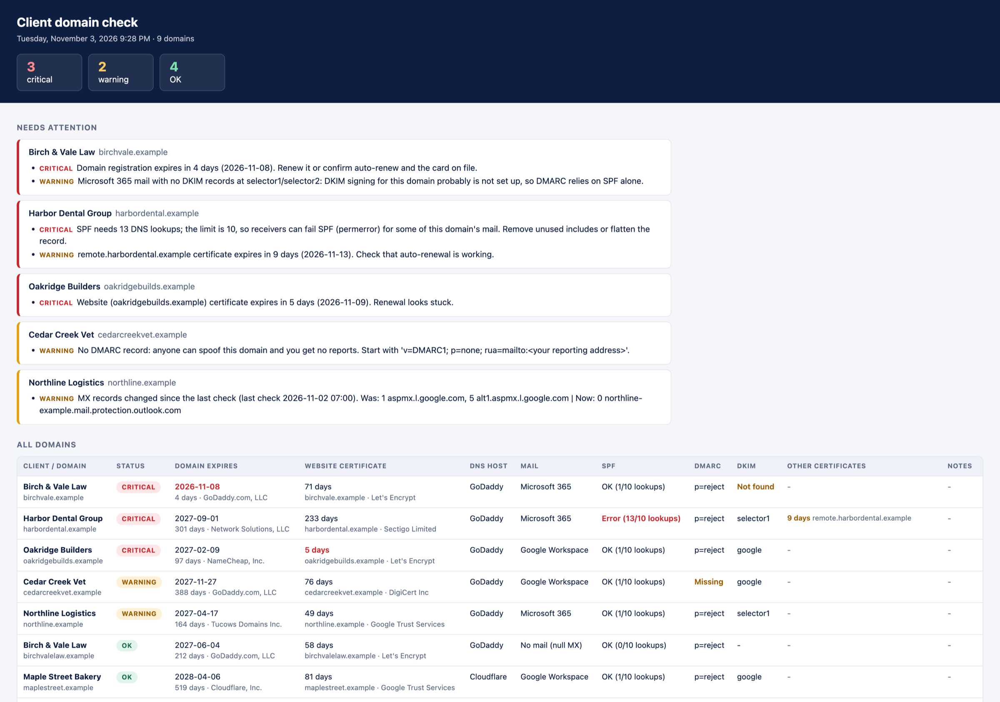

# Client Domain Check

A free PowerShell script that checks all your clients' domains every morning and tells you which ones need attention: before a domain lapses, a certificate expires, or someone quietly changes the MX records.

One file, read-only, no modules, no API keys, no agent. Runs in Windows PowerShell 5.1 and PowerShell 7.


*Sample report generated from fictional clients (`tests/New-SampleReport.ps1`).*

## What it checks

| Area | What you get told about |
|---|---|
| **Domain registration** | Expiry date and registrar (from the registry's RDAP server). Warns at 30 days, critical at 7. Also flags *pending delete*, *redemption*, *hold*, a transfer in progress, and the auto-renew grace period, when the registry date has rolled forward but the registrar can still delete an unpaid domain. |
| **Website certificate** | Days left, and whether it's trusted and covers the name. Checks `domain.com`, or `www.domain.com` if the bare domain has no site. Warns at 14 days, critical at 7. |
| **Your other certificates** | Any hosts you list, such as RD Gateway, the firewall's SSL VPN portal or on-prem Exchange, with optional ports. |
| **SPF** | Missing record, more than one record, `+all`, includes that point to nothing, and the **10-DNS-lookup limit**, counted through nested includes the way receivers count it. |
| **DMARC** | Missing, duplicated or invalid records; notes `p=none` and missing `rua` reporting. |
| **DKIM** | Looks for keys at common selectors, and specifically catches Microsoft 365 domains where DKIM was never enabled. |
| **Changes** | Nameservers, MX, SPF, DMARC or registrar changed since the last run: the web designer who "fixed" DNS, or a migration nobody told you about. Alerts once, then the new value becomes the baseline. |

You get an HTML report (problems first), a CSV for your PSA or spreadsheet, and optionally a summary in Teams or Slack. The exit code is `0` all clear, `1` warnings, `2` critical, so an RMM or Task Scheduler can alert on it. `3` means the check couldn't run at all, for example because the network blocks encrypted DNS; that is posted to Teams or Slack too, so a scheduled run never fails silently.

## Quick start

1. Download `Test-ClientDomains.ps1` into a folder, for example `C:\DomainCheck`. If Windows blocks it, run `Unblock-File .\Test-ClientDomains.ps1`.
2. Copy `domains.example.csv` to `domains.csv` in the same folder and fill it in:

   ```csv
   Client,Domain,CertHosts
   Contoso,contoso.com,remote.contoso.com; vpn.contoso.com:4443
   Fabrikam,fabrikam.com,
   ```

   `CertHosts` is optional: extra hosts whose certificates you care about, separated by semicolons, with `:port` if it isn't 443. A plain text file with one domain per line also works.
3. Run it:

   ```powershell
   .\Test-ClientDomains.ps1 -Open
   ```

The report and CSV go into a `reports` folder next to the script, along with a small state file used to spot changes between runs. To check a couple of domains without a file: `.\Test-ClientDomains.ps1 -Domain contoso.com, fabrikam.com -Open`.

A list of 100 domains takes a few minutes. The checks run one at a time to stay polite to the registries.

## Run it every morning

**Task Scheduler** (elevated PowerShell; runs as SYSTEM whether or not anyone is logged on):

```powershell
$action    = New-ScheduledTaskAction -Execute 'powershell.exe' -Argument '-NoProfile -ExecutionPolicy Bypass -File "C:\DomainCheck\Test-ClientDomains.ps1"'
$trigger   = New-ScheduledTaskTrigger -Daily -At 7am
$principal = New-ScheduledTaskPrincipal -UserId 'SYSTEM' -LogonType ServiceAccount -RunLevel Highest
Register-ScheduledTask -TaskName 'Client domain check' -Action $action -Trigger $trigger -Principal $principal
```

Add `-WebhookUrl "<your Teams or Slack webhook>"` to the argument string to get the summary in chat.

**RMM:** run it as a daily script on one machine you control. Keep the list and reports in a fixed folder so change tracking survives between runs, and alert on a non-zero exit code:

```powershell
.\Test-ClientDomains.ps1 -InputFile C:\ProgramData\DomainCheck\domains.csv -OutputFolder C:\ProgramData\DomainCheck\reports
```

## Teams or Slack alerts

Pass `-WebhookUrl`. A summary is posted only when something needs attention; add `-NotifyAlways` to get a daily "all clear" too.

- **Microsoft Teams:** Office 365 connector webhooks were retired in 2026. Create a webhook with Teams **Workflows** instead (for example, the *"Send webhook alerts to a channel"* template) and use the URL it gives you. The script posts an Adaptive Card in the format Workflows expects.
- **Slack:** create an incoming webhook (`https://hooks.slack.com/services/...`). The script detects Slack URLs and sends a plain message.

## Options

| Parameter | Default | |
|---|---|---|
| `-InputFile` | `domains.csv` next to the script | CSV (`Client,Domain,CertHosts`) or text file |
| `-Domain` | | Check these instead of a file. From cmd, Task Scheduler or an RMM, pass one quoted list: `-Domain "a.com,b.com"` |
| `-OutputFolder` | `reports` next to the script | Reports, CSV and the change-tracking state file |
| `-WebhookUrl`, `-NotifyAlways` | | Teams Workflows or Slack summary |
| `-DomainWarnDays`, `-DomainCriticalDays` | 30, 7 | Registration thresholds |
| `-CertWarnDays`, `-CertCriticalDays` | 14, 7 | Certificate thresholds. Certificates that last 30 days or less, such as 6-day certificates, are only flagged when renewal has stalled |
| `-DkimSelectors` | `selector1, selector2, google, default, k1, s1, s2` | Add your own selectors |
| `-DnsResolver` | `Cloudflare` | `Cloudflare` or `Google` DNS over HTTPS. If it can't be reached, the other one is used and the report says so |
| `-Open`, `-PassThru` | | Open the report; output result objects for your own scripting |

## Is it safe to run?

- **Read-only.** It reads public DNS records, public registry data and the certificate a website presents. It never logs in to anything, changes anything, or needs credentials.
- **Where your list goes:** domain names are sent to the DNS-over-HTTPS resolver you pick (Cloudflare or Google, and the other one only if yours can't be reached) and to each domain's registry RDAP server; the script connects to each website and host you list on its HTTPS port. Nothing else, and no telemetry.
- **Nothing compiled or downloaded at runtime.** It's a single readable `.ps1` with no modules and no `Add-Type` C# compilation, a behavior EDR tools often flag.
- Public DNS is used on purpose, so internal split-DNS answers don't hide what the internet sees. Certificate checks connect through the machine's normal network, so internal hosts in `CertHosts` work if that machine can reach them.

## Limits worth knowing

- **Network access:** the machine needs outbound HTTPS to `cloudflare-dns.com` or `dns.google`, to `data.iana.org` and the registries' RDAP servers, and to the hosts it checks. DNS filters (Umbrella, DNSFilter and the like) often block encrypted DNS. If both resolvers are blocked, the script stops with exit code `3` and says what to allow. Web lookups follow the system proxy settings, but certificate checks connect directly, and proxies that require a login aren't supported.
- **Registration data:** some country registries, including `.de`, don't publish expiry dates over RDAP. The report says so instead of guessing. For gTLDs like `.com`, the date is the *registry's*; the auto-renew grace check covers the case where it rolled forward without payment.
- **DKIM selectors can be named anything,** so "not found at common selectors" is a note, not a warning. The Microsoft 365 check is the exception, because Microsoft always uses `selector1`/`selector2`.
- **SPF:** lookups are counted per RFC 7208, through nested includes. Terms with macros (such as Salesforce's `exists:%{i}...`) are counted but can't be followed, so includes behind them aren't seen.
- It checks the website at the domain or `www.`, not every subdomain. Put anything else in `CertHosts`.

## Tests

```powershell
.\tests\Run-Tests.ps1      # offline: DNS, RDAP and TLS replaced with fixtures
.\tests\Live-Tests.ps1     # live: real lookups against hosts with known properties (e.g. expired.badssl.com)
```

GitHub Actions runs both on Windows PowerShell 5.1, PowerShell 7 on Windows and PowerShell 7 on Linux, and tests the Task Scheduler steps above on a Windows runner.

## License

MIT. Made by [Waxwing Factory](https://waxwingfactory.com). Issues and pull requests welcome.
